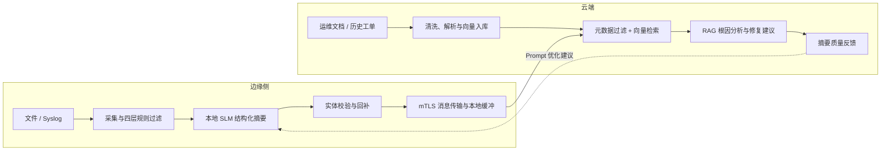

# edge-semantic-compress-intelligence

边缘日志智能压缩与云端 RAG 故障分析系统。边缘侧通过规则过滤和本地小模型提炼日志，云端侧结合运维知识库检索历史案例并生成根因分析与修复建议。

仓库包含需求、技术方案、PRD 和架构决策文档。目前已实现 Edge Agent HTTP 入口与 Fluent Bit 文件/Syslog 配置、llama.cpp JSON Schema 约束摘要器适配器、强制 mTLS/Topic ACL 的 MQTT 传输、SQLite outbox、可运行的云端 MQTT 消费/RAG CLI、MarkItDown 原始文档转换及知识入库、bge-m3 HTTP 客户端、Milvus VectorIndex/集合初始化适配器、强制 IP 元数据过滤的混合检索，以及带人工审核状态机的 Prompt 反馈闭环。生产 CA/证书、真实 SLM、运行中的 Embedding/云端模型及自动化 Prompt 分发仍待部署。

## 架构概览



边缘侧不部署 Embedding 模型；模型输出通过 JSON Schema 或 Grammar 约束。各组件边界、约束和待定选型以需求、PRD 和 ADR 文档为准。

## 文档导航

- [需求文档](docs/requirements)：业务目标、功能需求和非功能性约束。
- [技术方案](docs/technology)：参考架构、数据流程、组件候选及实施阶段。
- [PRD 索引](docs/prds/README.md)：按可交付能力拆分的需求、验收标准和依赖。
- [ADR 索引](docs/adr/README.md)：架构决策、替代方案、状态及尚待确认的选型。

建议阅读顺序：需求文档 → 技术方案 → PRD 索引及对应 PRD → ADR 索引及相关决策。

## 建议实施顺序

1. **端到端 MVP**：边缘规则过滤、云端知识入库、混合检索与 RAG；可先使用规则模拟摘要验证云端链路。
2. **边缘智能提炼**：接入本地 SLM、Schema 约束输出和实体校验，并完成端到端联调。
3. **可靠性与反馈闭环**：完善安全传输、弱网补传、运行观测和 Prompt 建议评估。

详细依赖和验收要求见 [PRD 索引](docs/prds/README.md)。MQTT/Kafka、向量存储、模型格式等未定选型见 [ADR 索引](docs/adr/README.md)。

## 本地开发

需要 Python 3.11 或更高版本。当前代码切片仅使用 Python 标准库，可直接运行测试：

```bash
PYTHONPATH=src python3 -m unittest discover -s tests -v
```

需要运行真实服务集成测试时，安装 `.[milvus,transport,documents]` 并先生成本地开发证书：

```bash
bash scripts/generate-dev-mqtt-certs.sh
docker compose up -d --build --wait
RUN_MQTT_INTEGRATION=1 PYTHONPATH=src python3 -m unittest tests.test_mqtt_integration -v
RUN_MILVUS_INTEGRATION=1 PYTHONPATH=src python3 -m unittest tests.test_milvus_integration -v
RUN_FLUENT_BIT_INTEGRATION=1 PYTHONPATH=src python3 -m unittest tests.test_fluentbit_integration -v
docker compose stop
```

集成测试使用临时 SQLite 数据库和唯一 Milvus collection，并在测试结束时清理；Fluent Bit 测试覆盖 JSONL 文件 Tail 与 UDP Syslog 输入。

边缘事件契约定义在 [`schemas/edge-event-v1.schema.json`](schemas/edge-event-v1.schema.json)。预过滤 MVP 接收包含 `timestamp`、`service`、`message` 的 JSON Lines 记录；具体输入适配器可在后续接入 Fluent Bit。当前摘要器和 RAG 模型均为确定性 mock，不执行真实模型推理。云端 adapter 可初始化兼容的 Milvus 集合；实际检索/入库仍需运行 Milvus 和 bge-m3 HTTP 服务。

端口回补仅从显式端口字段或带端口标签的日志文本提取，避免将其他数字误当作端口。

安装云端、传输和文档解析适配器依赖：

```bash
python3 -m pip install -e '.[milvus,transport,documents]'
```

先运行 `bash scripts/generate-dev-mqtt-certs.sh`，再用 `docker compose up -d --build` 启动 Edge Agent、Fluent Bit、Cloud RAG Agent、Mosquitto、Milvus 及其依赖。MQTT 使用 mTLS TLS 8883：Edge 证书只可发布 `edge/events`，Cloud 证书只可订阅该主题；匿名和明文连接不开放。开发证书仅供本地使用，不能用于生产。Fluent Bit 读取 `./examples/logs/*.jsonl` 并监听 UDP Syslog 5514。开发环境默认使用 mock SLM、embedding 和分析模型；设置 `EDGE_SUMMARIZER=llama_cpp` 并配置 `EDGE_LLAMA_URL` 可接入本地 llama.cpp，云端模式可通过 `CLOUD_EMBEDDING_MODE`、`CLOUD_EMBEDDING_URL`、`CLOUD_ANALYSIS_MODE`、`CLOUD_ANALYSIS_URL` 配置。SQLite outbox 默认上限为 100 MiB，满载时拒绝新消息。

导入样例或实际运维文档（Markdown、TXT、JSONL、PDF、DOCX、PPTX、HTML）：将文件放入 `examples/knowledge/sources` 或挂载到该目录，再运行：

```bash
docker compose --profile tools run --rm knowledge-ingest
```

文档解析要求显式 `Summary` 和 `Resolution` 字段；字段不足时会报错，不会让模型补写事实。可用以下命令审核建议：

```bash
docker compose --profile tools run --rm feedback-admin
docker compose --profile tools run --rm feedback-admin --db /var/lib/cloud/feedback.sqlite3 review <suggestion-id> --approve --reviewer <name> --note "validated against labeled cases"
docker compose --profile tools run --rm feedback-admin --db /var/lib/cloud/feedback.sqlite3 publish <suggestion-id>
docker compose --profile tools run --rm feedback-admin --db /var/lib/cloud/feedback.sqlite3 weekly-report
```

`publish` 只记录人工确认状态，不会远程推送或自动替换 Edge Prompt。