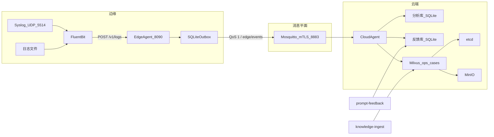
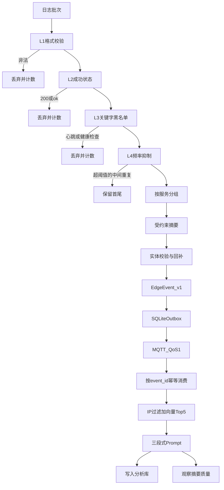
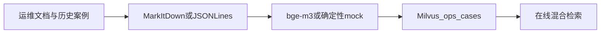
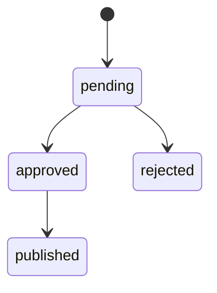

# edge-semantic-compress-intelligence

边缘日志智能压缩与云端 RAG 故障分析系统。边缘侧通过规则过滤和本地小模型提炼日志，云端侧结合运维知识库检索历史案例并生成根因分析与修复建议。

仓库包含需求、技术方案、按服务编写的实现说明、PRD 和架构决策文档。代码也按服务分包：边缘是过滤、摘要、传输和 edge agent；云端是知识入库、检索、RAG、反馈和 cloud agent。生产 CA/证书、真实 SLM、运行中的 Embedding/云端模型及自动化 Prompt 分发仍待部署。

## 架构设计

系统在带宽和边缘算力受限的条件下做故障诊断。边缘把原始日志压成稳定的结构化事件；云端用运维知识做检索增强分析。两侧只通过 `EdgeEvent` 契约耦合，云端不绑定边缘 SLM 的模型版本，边缘不部署 Embedding。服务边界和代码位置见 [服务目录](docs/services/README.md)。按服务粒度管理代码与文档的规则见 [ADR-0010](docs/adr/adr-0010-service-granularity.md)，边缘与云端的职责划分见 [ADR-0001](docs/adr/adr-0001-edge-cloud-boundary.md)。

### 部署视图

本地拓扑由 [compose.yaml](compose.yaml) 定义。Fluent Bit 读取挂载日志目录，并在 UDP `5514` 接收 Syslog，归一化后 `POST` 到 [edge agent](docs/services/edge/agent.md)。edge agent 监听 `8090`，内部依次调用过滤、摘要和传输，经 MQTT `8883` 发布事件。[cloud agent](docs/services/cloud/agent.md) 订阅同一主题，调用检索和 RAG，并写入本地分析库与反馈库。Milvus 单机模式依赖 etcd 和 MinIO。[知识入库](docs/services/cloud/knowledge.md)与[反馈](docs/services/cloud/feedback.md)审核是独立进程，挂在 Compose profile `tools` 上，不随主链路常驻。

### 服务

各服务的职责、边界和代码路径见 [服务目录](docs/services/README.md)。进程只有四个：`edge-log-agent`、`cloud-rag-agent`、`knowledge-ingest`、`prompt-feedback`。过滤、摘要、传输由 edge agent 调用；检索和 RAG 由 cloud agent 调用。反馈同时有在线观察和独立审核进程。

跨部署边界是 [`shared` 中的 `EdgeEvent`](docs/services/shared.md)。Mosquitto 提供 mTLS 和 Topic ACL：`edge-agent` 只写、`cloud-agent` 只读 `edge/events`；`healthcheck` 只读 `$SYS/broker/uptime`。

### 在线故障分析

一条日志批次由 [过滤](docs/services/edge/filtering.md)、[摘要](docs/services/edge/summarization.md) 和 [传输](docs/services/edge/transport.md) 完成压缩，再由 [cloud agent](docs/services/cloud/agent.md) 完成一次 [检索](docs/services/cloud/retrieval.md) 和 [RAG](docs/services/cloud/rag.md)。L4 对同一服务、同一消息超过阈值的重复项只保留首尾。摘要按服务各生成一个事件。

检索在缺少 `target_ip` 或没有精确 IP 匹配时返回空案例集，不退化为纯向量搜索。Prompt 固定为 `<edge_summary>`、`<retrieved_cases>`、`<analysis_instructions>` 三段，摘要和案例按不可信数据转义。策略见 [检索服务](docs/services/cloud/retrieval.md) 和 [ADR-0006](docs/adr/adr-0006-hybrid-retrieval.md)。

### 知识入库

知识平面与在线链路分开，由 [知识入库服务](docs/services/cloud/knowledge.md) 单独运行。它读取运维文档或历史案例，解析为带 `target_ip` 的案例，通过检索服务写入 Milvus `ops_cases`。入库元数据与检索过滤使用同一 IP 字段。

### 反馈治理

[反馈服务](docs/services/cloud/feedback.md) 在 cloud agent 完成 RAG 后观察该事件。可选实体有缺失时生成 `missing_entities` 建议；实体齐全但召回为空时生成 `no_retrieved_cases` 建议。审核 CLI 是独立进程。发布只记录状态，不替换 edge agent 的线上 Prompt。治理要求见该服务说明和 [ADR-0008](docs/adr/adr-0008-feedback-governance.md)。

### 可靠性与安全

[传输服务](docs/services/edge/transport.md) 提供至少一次投递：先写入 outbox，收到 broker 确认后才删除。该确认不表示云端业务已完成。[cloud agent](docs/services/cloud/agent.md) 在业务处理成功且去重记录落盘后才手动 ACK。接入强制 mTLS。检索在向量库过滤之后再次比对 IP。

### 实现状态

已实现：过滤、摘要、传输、edge agent、知识入库、检索、RAG、反馈和 cloud agent。Fluent Bit 的文件与 Syslog 配置也已提供。

待部署：生产 CA 与证书轮换、目标硬件上的真实 SLM、运行中的 Embedding 与分析模型、已批准 Prompt 的分发与回滚、预过滤引擎的 Prometheus 指标。Kafka、Elasticsearch、LlamaIndex 仍是 ADR 中的候选，不在当前运行路径上。

选型与约束以 [ADR 索引](docs/adr/README.md) 为准。

## 文档导航

- [服务目录](docs/services/README.md)：每个服务的职责、边界和代码路径。
- [需求文档](docs/requirements)：业务目标、功能需求和非功能性约束。
- [技术方案](docs/technology)：参考架构、数据流程、组件候选及实施阶段。
- [PRD 索引](docs/prds/README.md)：按服务对应的需求、验收标准和依赖。
- [ADR 索引](docs/adr/README.md)：架构决策、替代方案、状态及尚待确认的选型。
- [本地开发](docs/local-development.md)：按服务运行测试、启动 Compose、知识入库和反馈审核。

建议阅读顺序：需求文档 → 技术方案 → 服务目录 → 对应 PRD → 相关 ADR。

## 建议实施顺序

1. **端到端 MVP**：边缘规则过滤、云端知识入库、混合检索与 RAG；可先使用规则模拟摘要验证云端链路。
2. **边缘智能提炼**：接入本地 SLM、Schema 约束输出和实体校验，并完成端到端联调。
3. **可靠性与反馈闭环**：完善安全传输、弱网补传、运行观测和 Prompt 建议评估。

详细依赖和验收要求见 [PRD 索引](docs/prds/README.md)。MQTT/Kafka、向量存储、模型格式等未定选型见 [ADR 索引](docs/adr/README.md)。
