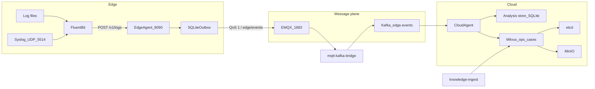
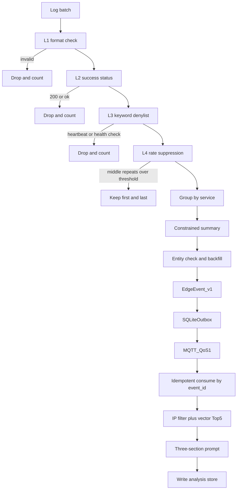
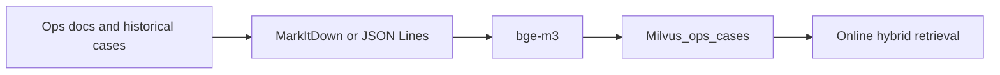

# edge-semantic-compress-intelligence

An edge log compression and cloud RAG fault-analysis system. On the edge, rule filtering and a local small model distill logs. In the cloud, an operations knowledge base retrieves historical cases and produces root-cause analysis and remediation suggestions.

The repository contains requirements, the technical design, per-service implementation notes, PRDs, and architecture decision records. The edge application lives in `services/edge-agent`. The cloud processes live in `services/cloud-agent`, `services/mqtt-kafka-bridge`, and `services/knowledge-ingest`. Inside the edge application, the business modules are filtering, summarization, transport, and the edge agent. Retrieval and RAG live in `libs/cloud`. The shared contract lives in `libs/shared`. A real SLM, a running embedding model and cloud model, and automated prompt distribution are still to be deployed.

## Architecture

The system diagnoses faults under limited bandwidth and edge compute. The edge compresses raw logs into stable structured events. The cloud uses operations knowledge for retrieval-augmented analysis. The two sides couple only through the `EdgeEvent` contract. The cloud is not tied to the edge SLM model version, and the edge does not run embeddings. Service boundaries and code locations are in the [service catalog](docs/services/README.md). Rules for managing code and docs at service granularity are in [ADR-0010](docs/adr/adr-0010-service-granularity.md). The split of responsibilities between edge and cloud is in [ADR-0001](docs/adr/adr-0001-edge-cloud-boundary.md).

### Deployment view

The local topology is defined in [compose.yaml](compose.yaml). Fluent Bit reads the mounted log directory and receives syslog on UDP `5514`. After normalization it `POST`s to the [edge agent](docs/services/edge/agent.md). The edge agent listens on `8090` and internally calls filtering, summarization, and transport in order, then publishes events over MQTT `1883`. EMQX accepts that publish. The MQTT-to-Kafka bridge subscribes to `edge/events` and writes the same payload to Kafka topic `edge.events` after Kafka acknowledges it. The [cloud agent](docs/services/cloud/agent.md) consumes that Kafka topic, calls retrieval and RAG, and writes the local analysis store. Milvus standalone mode depends on etcd and MinIO. [Knowledge ingestion](docs/services/cloud/knowledge.md) is a separate process on the Compose profile `tools`, and it does not stay up with the main path.

### Services

Responsibilities, boundaries, and code paths for each service are in the [service catalog](docs/services/README.md). There are four processes: `edge-log-agent`, `mqtt-kafka-bridge`, `cloud-rag-agent`, and `knowledge-ingest`. Filtering, summarization, and transport are called by the edge agent. Retrieval and RAG are called by the cloud agent.

The contract across the deployment boundary is [`EdgeEvent` in `shared`](docs/services/shared.md). EMQX listens on plaintext MQTT `1883` and enforces topic ACLs by MQTT username: `edge-agent` may only publish to `edge/events`, and `mqtt-kafka-bridge` may only subscribe to it.

### Online fault analysis

A log batch is compressed by [filtering](docs/services/edge/filtering.md), [summarization](docs/services/edge/summarization.md), and [transport](docs/services/edge/transport.md). The [cloud agent](docs/services/cloud/agent.md) then runs one [retrieval](docs/services/cloud/retrieval.md) and one [RAG](docs/services/cloud/rag.md) pass. At L4, repeated items for the same service and the same message above the threshold keep only the first and last occurrence. Summarization produces one event per service.

When `target_ip` is missing or there is no exact IP match, retrieval returns an empty case set and does not fall back to vector-only search. The prompt is fixed as three sections: `<edge_summary>`, `<retrieved_cases>`, and `<analysis_instructions>`. Summaries and cases are escaped as untrusted data. The policy is described in the [retrieval service](docs/services/cloud/retrieval.md) and [ADR-0006](docs/adr/adr-0006-hybrid-retrieval.md).

### Knowledge ingestion

The knowledge plane is separate from the online path and runs on its own through the [knowledge ingestion service](docs/services/cloud/knowledge.md). It reads operations documents or historical cases, parses them into cases that carry `target_ip`, and writes them to the Milvus collection `ops_cases` through the retrieval service. Ingestion metadata and retrieval filters use the same IP field.

### Reliability and security

The [transport service](docs/services/edge/transport.md) provides at-least-once delivery: it writes the outbox first and deletes the record only after the broker acknowledges it. That acknowledgement does not mean cloud-side business processing has finished. The [cloud agent](docs/services/cloud/agent.md) sends a manual ACK only after business processing succeeds and the deduplication record is persisted. After the vector store applies its filter, retrieval compares the IP again.

### Implementation status

Implemented: filtering, summarization, transport, the edge agent, knowledge ingestion, retrieval, RAG, and the cloud agent. Fluent Bit file and syslog configuration is included.

Still to deploy: distribution and rollback of approved prompts, and Prometheus metrics for the pre-filter. Local Compose sets SiliconFlow through `SILICONFLOW_BASE_URL`, `SILICONFLOW_API_KEY`, and the edge, embedding, and analysis model names. Kafka, Elasticsearch, and LlamaIndex remain candidates in the ADRs and are off the current runtime path.

Technology choices and constraints follow the [ADR index](docs/adr/README.md).

## Documentation

- [Service catalog](docs/services/README.md): responsibilities, boundaries, and code paths for each service.
- [Requirements](docs/requirements): business goals, functional requirements, and non-functional constraints.
- [Technical design](docs/technology): reference architecture, data flow, component candidates, and implementation phases.
- [PRD index](docs/prds/README.md): requirements, acceptance criteria, and dependencies for each service.
- [ADR index](docs/adr/README.md): architecture decisions, alternatives, status, and choices still to confirm.
- [Local development](docs/local-development.md): run tests per service, start Compose, and ingest knowledge.

Suggested reading order: requirements, then the technical design, the service catalog, the matching PRD, and the related ADRs.

## Suggested implementation order

1. **End-to-end MVP**: edge rule filtering, cloud knowledge ingestion, hybrid retrieval, and RAG. A rule-based simulated summary can validate the cloud path first.
2. **Edge intelligent distillation**: add a local SLM, schema-constrained output, and entity validation, then finish end-to-end integration.
3. **Reliability**: secure transport and retry on weak networks.

Dependencies and acceptance criteria are in the [PRD index](docs/prds/README.md). Open choices such as MQTT or Kafka, vector storage, and model format are in the [ADR index](docs/adr/README.md).
