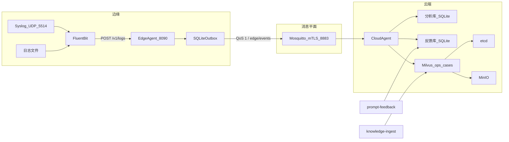
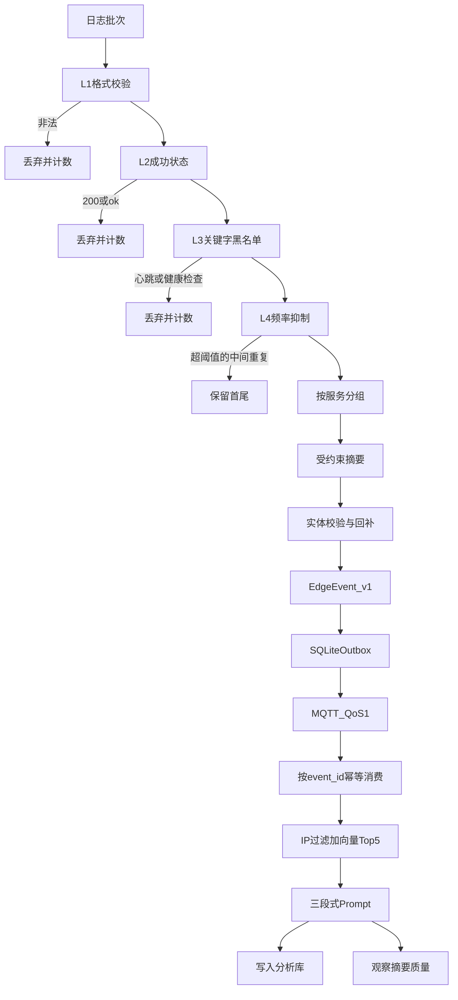
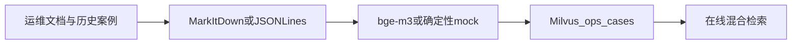
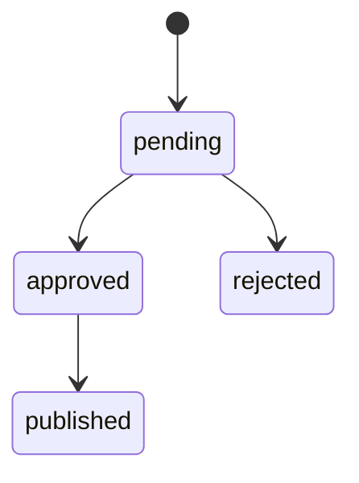

# edge-semantic-compress-intelligence

边缘日志智能压缩与云端 RAG 故障分析系统。边缘侧通过规则过滤和本地小模型提炼日志，云端侧结合运维知识库检索历史案例并生成根因分析与修复建议。

仓库包含需求、技术方案、PRD 和架构决策文档。目前已实现 Edge Agent HTTP 入口与 Fluent Bit 文件/Syslog 配置、llama.cpp JSON Schema 约束摘要器适配器、强制 mTLS/Topic ACL 的 MQTT 传输、SQLite outbox、可运行的云端 MQTT 消费/RAG CLI、MarkItDown 原始文档转换及知识入库、bge-m3 HTTP 客户端、Milvus VectorIndex/集合初始化适配器、强制 IP 元数据过滤的混合检索，以及带人工审核状态机的 Prompt 反馈闭环。生产 CA/证书、真实 SLM、运行中的 Embedding/云端模型及自动化 Prompt 分发仍待部署。

## 架构设计

系统在带宽和边缘算力受限的条件下做故障诊断。边缘把原始日志压成稳定的结构化事件；云端用运维知识做检索增强分析。两侧只通过 `EdgeEvent` 契约耦合，云端不绑定边缘 SLM 的模型版本，边缘不部署 Embedding。职责划分见 [ADR-0001](docs/adr/adr-0001-edge-cloud-boundary.md)。

### 部署视图

本地拓扑由 [compose.yaml](compose.yaml) 定义。Fluent Bit 读取挂载日志目录，并在 UDP `5514` 接收 Syslog，归一化后 `POST` 到 Edge Agent。Edge Agent 监听 `8090`，经 MQTT `8883` 发布事件。Cloud Agent 订阅同一主题，检索 Milvus 并写入本地分析库与反馈库。Milvus 单机模式依赖 etcd 和 MinIO。知识入库与反馈审核是独立 CLI，挂在 Compose profile `tools` 上，不随主链路常驻。

### 组件与接口

| 组件 | 职责 | 对外边界 |
|---|---|---|
| Fluent Bit | 采集文件与 Syslog，做采集侧缓冲，把日志批次交给 Edge Agent | `POST /v1/logs`，正文为 UTF-8 日志行，默认上限 1 MiB |
| `EdgeRuntime` | 纯规则过滤，按 `service` 分组后摘要，再提交传输 | 进程内编排，不调用 Embedding |
| `RuleFilter` | L1 格式、L2 成功状态、L3 关键字、L4 重复抑制 | 丢弃原因计数：`invalid_format`、`success_status`、`blacklisted_keyword`、`frequency_suppressed` |
| 摘要器 | mock 或 llama.cpp，输出受 JSON Schema 约束 | `LlamaCppSummarizer` 走 llama.cpp server；`EDGE_SUMMARIZER=mock` 用于无模型联调 |
| `SummaryPipeline` | 校验摘要并用原始日志回补 IP、端口、错误码 | 只从本批日志提取，缺字段保持空值 |
| `ReliableMqttTransport` | MessagePack 编码，QoS 1 发布，确认前留在 outbox | 主题默认 `edge/events`；`GET /healthz` 只表示进程存活 |
| Mosquitto | mTLS 接入和 Topic ACL | `edge-agent` 只写、`cloud-agent` 只读 `edge/events`；`healthcheck` 只读 `$SYS/broker/uptime` |
| `MqttEventConsumer` | 解码、按 `event_id` 去重、调用业务后再手动 ACK | 处理记录在 `processed.sqlite3` |
| `KnowledgeIngestor` | MarkItDown 或 JSON Lines 解析运维文档，向量化后写入 Milvus | CLI `knowledge-ingest`，集合 `ops_cases`，向量维度 1024 |
| `HybridRetriever` | `target_ip` 精确过滤加 `summary` 向量相似度 | 固定 Top-5，结果再次校验 IP |
| `RagService` | 组装不可信数据 Prompt，调用分析模型 | mock 或 OpenAI 兼容接口；结果写入 `analyses.sqlite3` |
| `PromptFeedbackService` | 根据摘要缺口生成建议并走人工审核 | CLI `prompt-feedback`；发布状态不推送边缘 Prompt |

### 数据契约

跨部署边界是 `EdgeEvent` schema `1.0`，机器可读定义在 [schemas/edge-event-v1.schema.json](schemas/edge-event-v1.schema.json)，决策见 [ADR-0009](docs/adr/adr-0009-edge-event-contract.md)。

- 必填：`event_id`（UUID）、`schema_version`、带时区的 ISO 8601 `timestamp`、非空 `service`、非空 `summary`。
- 可选：`target_ip`、`target_port`、`error_code`。IP 必须可解析；端口为 1–65535。
- 未知字段拒绝。事件不含原始日志。
- 模型输出遵守摘要 Schema；线路上使用 MessagePack。JSON 是模型约束，MessagePack 是传输编码。

### 在线故障分析

一条日志批次在边缘完成压缩，在云端完成一次检索和推理。L4 对同一服务、同一消息超过阈值的重复项只保留首尾。摘要按服务各生成一个事件。

检索在缺少 `target_ip` 或没有精确 IP 匹配时返回空案例集，不退化为纯向量搜索。Prompt 固定为 `<edge_summary>`、`<retrieved_cases>`、`<analysis_instructions>` 三段，摘要和案例按不可信数据转义。策略见 [ADR-0006](docs/adr/adr-0006-hybrid-retrieval.md)。

### 知识入库

知识平面与在线链路分开。`knowledge-ingest` 读取运维文档或历史案例，解析为带 `target_ip` 的案例，调用 bge-m3 HTTP 嵌入（本地可用确定性 mock），写入 Milvus `ops_cases`。入库元数据与检索过滤使用同一 IP 字段，保证在线检索能做精确过滤。

### 反馈治理

Cloud Agent 完成 RAG 后观察该事件。可选实体有缺失时生成 `missing_entities` 建议；实体齐全但召回为空时生成 `no_retrieved_cases` 建议。两类都按 `event_id + category` 去重，只保存事件标识和质量信号。建议包含证据、Prompt patch、预期指标、正反验证样本和风险说明。

状态只允许从 `pending` 进入 `approved` 或 `rejected`，已批准项才可标为 `published`。`prompt-feedback` 提供列表、审核、发布和近 7 天统计。发布只记录状态，不替换 Edge Agent 的线上 Prompt。治理要求见 [ADR-0008](docs/adr/adr-0008-feedback-governance.md)。

### 可靠性与安全

传输提供至少一次投递。Edge Agent 先把 MessagePack 写入 SQLite outbox，收到 broker 的 QoS 1 发布确认后才删除记录。该确认表示 broker 已接收，不表示云端业务已完成。outbox 默认上限 100 MiB，达到上限时拒绝新事件并返回 HTTP 507，不覆盖旧记录。断线期间事件留在本地，连接恢复后补传。

Cloud Agent 使用 MQTT 手动 ACK。业务处理成功且 `event_id` 与载荷哈希落盘后才 ACK。相同 ID、相同载荷的重复消息直接 ACK，不再次调用处理器。相同 ID、不同载荷不 ACK。解码失败或处理失败也不 ACK，以便后续重投。业务在去重记录落盘前退出时仍可能重复执行，处理器按 `event_id` 保持幂等。

接入强制 mTLS，ACL 按证书 CN 限制主题权限。开发证书由仓库脚本生成且不入库；生产使用组织 CA、独立设备证书和受控密钥存储。本地 outbox 目前只收紧文件权限。检索侧在向量库过滤之后再次比对 IP，避免索引配置错误造成跨主机召回。

### 实现状态

已实现：Edge Agent HTTP 入口、Fluent Bit 文件与 Syslog 配置、四层规则过滤、llama.cpp JSON Schema 摘要适配器、实体回补、mTLS MQTT、SQLite outbox、云端消费与 RAG、MarkItDown 知识入库、bge-m3 HTTP 客户端、Milvus 集合适配器、强制 IP 过滤的混合检索，以及人工审核反馈状态机。

待部署：生产 CA 与证书轮换、目标硬件上的真实 SLM、运行中的 Embedding 与分析模型、已批准 Prompt 的分发与回滚、预过滤引擎的 Prometheus 指标。Kafka、Elasticsearch、LlamaIndex 仍是 ADR 中的候选，不在当前运行路径上。选型与约束以 [ADR 索引](docs/adr/README.md) 为准。

## 文档导航

- [需求文档](docs/requirements)：业务目标、功能需求和非功能性约束。
- [技术方案](docs/technology)：参考架构、数据流程、组件候选及实施阶段。
- [PRD 索引](docs/prds/README.md)：按可交付能力拆分的需求、验收标准和依赖。
- [ADR 索引](docs/adr/README.md)：架构决策、替代方案、状态及尚待确认的选型。
- [本地开发](docs/local-development.md)：运行测试、启动 Compose、知识入库和反馈审核。

建议阅读顺序：需求文档 → 技术方案 → PRD 索引及对应 PRD → ADR 索引及相关决策。

## 建议实施顺序

1. **端到端 MVP**：边缘规则过滤、云端知识入库、混合检索与 RAG；可先使用规则模拟摘要验证云端链路。
2. **边缘智能提炼**：接入本地 SLM、Schema 约束输出和实体校验，并完成端到端联调。
3. **可靠性与反馈闭环**：完善安全传输、弱网补传、运行观测和 Prompt 建议评估。

详细依赖和验收要求见 [PRD 索引](docs/prds/README.md)。MQTT/Kafka、向量存储、模型格式等未定选型见 [ADR 索引](docs/adr/README.md)。
