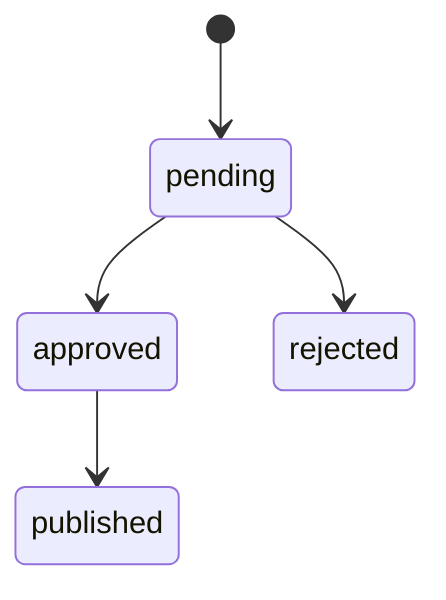

# Feedback

Code: [`services/feedback-admin/src/cloud/feedback`](../../../services/feedback-admin/src/cloud/feedback)

Process: `prompt-feedback`. The service name in the Compose profile `tools` is `feedback-admin`.

Related: [PRD-07](../../prds/prd-07-feedback-loop.md), [ADR-0008](../../adr/adr-0008-feedback-governance.md)

## Responsibilities

Record summary-quality suggestions from RAG results and provide human review. Publishing only changes status. It does not replace the edge prompt.

The [cloud agent](agent.md) calls the observation interface after analysis completes:

- Missing optional entities produce `missing_entities`.
- Complete entities with empty recall produce `no_retrieved_cases`.
- Both kinds are deduplicated by `event_id + category`. Only the event identifier and the quality signal are stored.

A suggestion includes evidence, a prompt patch, the expected metric, positive and negative validation samples, and a risk note. The only allowed states are:

The CLI provides `list`, `review`, `publish`, and statistics for the last 7 days. Commands are in [local development](../../local-development.md).
