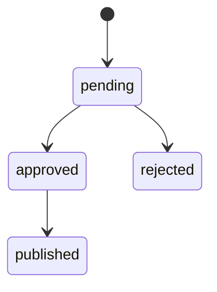

# 反馈

代码：[`services/cloud/feedback`](../../../src/edge_semantic_compress_intelligence/services/cloud/feedback)

进程：`prompt-feedback`。Compose profile `tools` 中的服务名是 `feedback-admin`。

关联：[PRD-07](../../prds/prd-07-feedback-loop.md)、[ADR-0008](../../adr/adr-0008-feedback-governance.md)

## 职责

根据 RAG 结果记录摘要质量建议，并提供人工审核。发布只改变状态，不替换边缘 Prompt。

[cloud agent](agent.md)在分析完成后调用观察接口：

- 可选实体缺失时生成 `missing_entities`。
- 实体齐全但召回为空时生成 `no_retrieved_cases`。
- 两类都按 `event_id + category` 去重，只保存事件标识和质量信号。

建议包含证据、Prompt patch、预期指标、正反验证样本和风险说明。状态只允许：

CLI 提供 `list`、`review`、`publish` 和近 7 天统计。命令见 [本地开发](../../local-development.md)。
